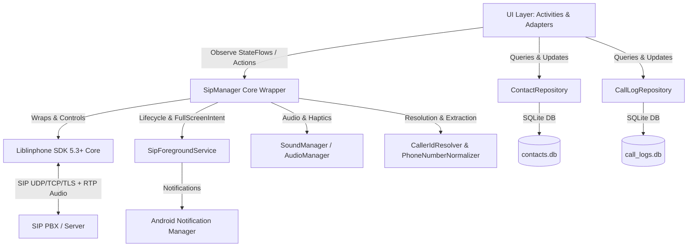

# 🏛️ Architecture & Technical Documentation

This document provides a comprehensive technical overview of the **SIP Phone** Android application, its internal components, data flows, and integrations.

---

## 📐 High-Level System Architecture

---

## 🧩 Core Components

### 1. `SipManager.kt` (`core/`)
The central controller and singleton wrapper around Liblinphone's `Core` instance.
- **Engine Lifecycle**: Initializes Liblinphone `Core` in `SipApplication.onCreate()`, manages `start()`, `stop()`, and listeners.
- **State Management**:
  - `registrationState: StateFlow<RegistrationStatus>` — Publishes real-time SIP registration status (`Unregistered`, `Registering`, `Registered`, `Failed`).
  - `activeCallData: StateFlow<ActiveCallData?>` — Publishes in-call metrics (call state, remote address, display name, duration, mute, hold, speaker, codec).
  - `incomingCallEvents: SharedFlow<ActiveCallData>` — Channel for navigation events when an incoming call arrives.
- **Listening Sockets & NAT**:
  - Sets `transports.udpPort = -1`, `tcpPort = -1`, `tlsPort = -1` (binds ephemeral listening sockets to receive incoming SIP packets without push servers).
  - Configures `NatPolicy` with STUN (`stun.linphone.org` / custom) and ICE for traversal across routers and mobile CGNAT.
  - Enables `isKeepAliveEnabled = true` and short registration expiration (`120s`) to prevent router firewall timeouts.

---

### 2. `SipForegroundService.kt` (`service/`)
Foreground service providing compliance with Android 14+ (`FOREGROUND_SERVICE_PHONE_CALL`) and lock screen call handling.
- **Notification Channels**:
  - `sip_incoming_calls_channel` (Importance: `HIGH`): Heads-up notification with sound, vibration, and quick action buttons (**Answer** & **Decline**).
  - `sip_call_foreground_channel` (Importance: `LOW`): Ongoing active call notification with **End Call** and click-to-return action.
- **Full-Screen Intent**:
  - Uses `setFullScreenIntent(pendingIntent, true)` targeting `IncomingCallActivity`.
  - Wakes up the screen when locked and displays the incoming call UI without being blocked by Android 10+ background activity restrictions.
- **Power & Connectivity Locks**:
  - Holds `PowerManager.PARTIAL_WAKE_LOCK` and `WifiManager.WifiLock` (`WIFI_MODE_FULL_LOW_LATENCY`) during active VoIP sessions to prevent CPU throttling or Wi-Fi sleep.

---

### 3. Data Repositories & SQLite (`data/`)

#### `CallLogRepository.kt` & `CallLogDbHelper.kt`
- SQLite database: `call_logs.db` (table: `call_logs`).
- Stores historical call records: `id`, `phone_number`, `display_name`, `call_type` (OUTGOING, INCOMING, MISSED), `timestamp`, and `duration_seconds`.
- Exposes `recentCalls: StateFlow<List<CallLogEntry>>` with automatic reactive re-emission on database changes.

#### `ContactRepository.kt` & `ContactDbHelper.kt`
- SQLite database: `contacts.db` (table: `contacts`).
- Manages app contacts (`id`, `name`, `phone_number`, `normalized_number`).
- Supports importing system contacts via Android `ContactsContract` and normalizes phone numbers using Google `libphonenumber`.
- Fast search functionality via `search(query)`.

---

### 4. Utilities (`util/`)

#### `CallerIdResolver.kt`
Resolves caller identity for incoming, active, and historical calls:
1. Strips SIP URI metadata (`sip:064726747@10.1.3.341` ➔ `064726747`).
2. Queries `ContactRepository` using clean number, extracted user, and raw input.
3. If matched, returns contact name and clean phone number.
4. If a valid display name was provided in the SIP header (not a SIP address, not numeric), returns it.
5. Fallback: Displays the clean extension or phone number (e.g. `064726747`), preventing raw SIP URIs from leaking into the UI.

#### `PhoneNumberNormalizer.kt`
Handles phone number and SIP address formatting:
- International conversion: `+44...` or `0044...` to national format (`0...`).
- Internal PBX extensions: 2-4 digit short extensions (`101`, `1001`) are strictly preserved.
- Alphanumeric SIP endpoints: Preserves service names (`echo`, `music`, `sip:music@sip.linphone.org`).
- User extraction: `extractUserFromSip` cleanly parses usernames from SIP URIs, angle brackets, and quotes.

#### `SoundManager.kt`
- DTMF audio playback using `ToneGenerator` across an isolated single-thread executor (`toneExecutor`) to ensure zero dialpad UI lag.
- Ringtone & vibration management using Android `RingtoneManager` and `Vibrator` / `VibratorManager`.

---

### 5. UI Layer (`ui/`)

| Screen / Class | Purpose |
|---|---|
| `MainActivity.kt` | 3-tab dashboard: Dialer (Material dialpad + keyboard toggle), Recents (call log), and Contacts (import & search). Controls registration status indicator. |
| `CallActivity.kt` | In-call screen with live call duration timer, Opus/PCMU codec badge, Mute, Speakerphone, Hold/Resume, and DTMF dialpad overlay. |
| `IncomingCallActivity.kt` | Full-screen incoming call ringing screen with caller name/number resolution, Ringtone & Vibration, and Answer/Decline buttons. |
| `SipSettingsActivity.kt` | Account configuration screen for SIP Domain/PBX, Port, Username/Extension, Password, Transport protocol (UDP/TCP/TLS), and STUN server. |
| `RecentCallsAdapter.kt` | RecyclerView adapter for call history with clean number resolution, dynamic initials avatar (never "SI"), call type icons, and one-tap callback. |
| `ContactsAdapter.kt` | RecyclerView adapter for contacts with quick call and delete actions. |
