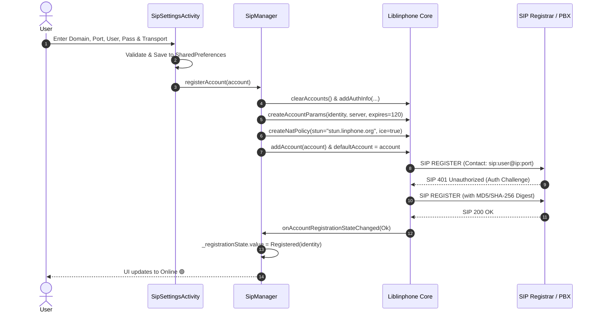
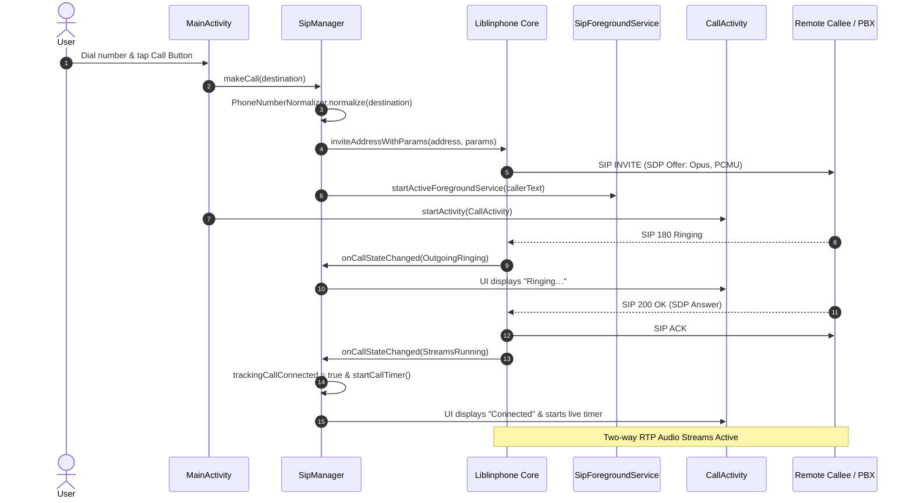
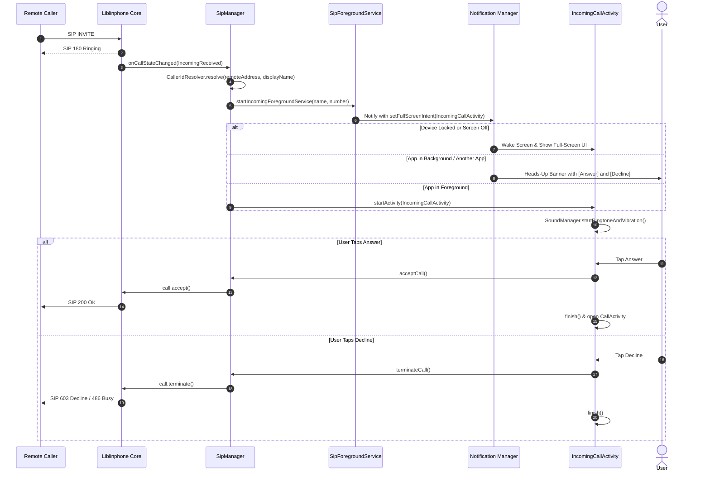
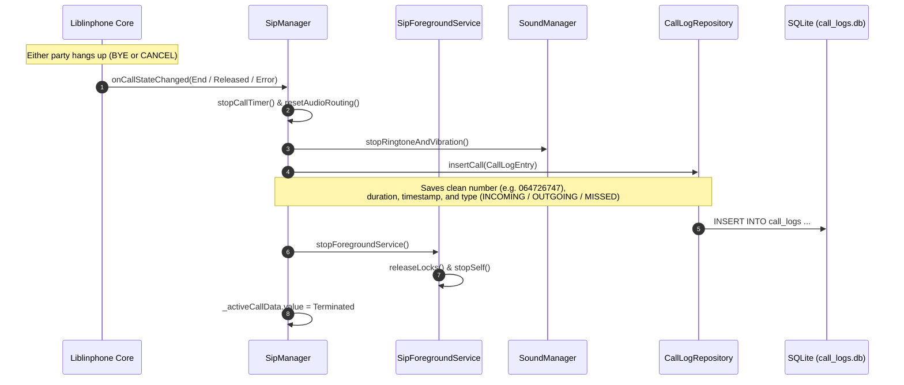

# 🔄 VoIP Call Flows & State Lifecycle

This document describes the operational call flows, state transitions, and background handling in **SIP Phone**.

---

## 1. 🟢 Registration Flow

---

## 2. 📞 Outgoing Call Flow

---

## 3. 📳 Incoming Call Flow

### Scenarios:
- **Case A: App is in Foreground (Open)** ➔ Opens `IncomingCallActivity` directly.
- **Case B: Device is Locked / Screen Off** ➔ `FullScreenIntent` notification wakes up the screen and displays `IncomingCallActivity`.
- **Case C: User is in another app (Background)** ➔ High-priority Heads-Up Notification appears with **Answer** and **Decline** buttons.

---

## 4. 🎛️ In-Call Control Operations

| Operation | Trigger | Underlying Action |
|---|---|---|
| **Mute / Unmute** | Tap Mute Button | `core.isMicEnabled = !core.isMicEnabled`. Updates `_activeCallData`. |
| **Speakerphone** | Tap Speaker Button | Toggles `AudioManager.mode = MODE_IN_COMMUNICATION` with `AudioDeviceInfo.TYPE_BUILTIN_SPEAKER` (Android 12+) and Linphone's `call.outputAudioDevice = AudioDevice.Type.Speaker`. |
| **Hold / Resume** | Tap Hold Button | Toggles `call.pause()` / `call.resume()`. Signals SIP re-INVITE (`a=sendonly` / `a=recvonly`). |
| **DTMF Keypad** | Tap Digit on In-Call Keypad | `call.sendDtmf(char)`. Transmits RFC 2833 / 4733 RTP telephony events across active audio stream. |

---

## 5. 🛑 Call Termination & Log Persistence

